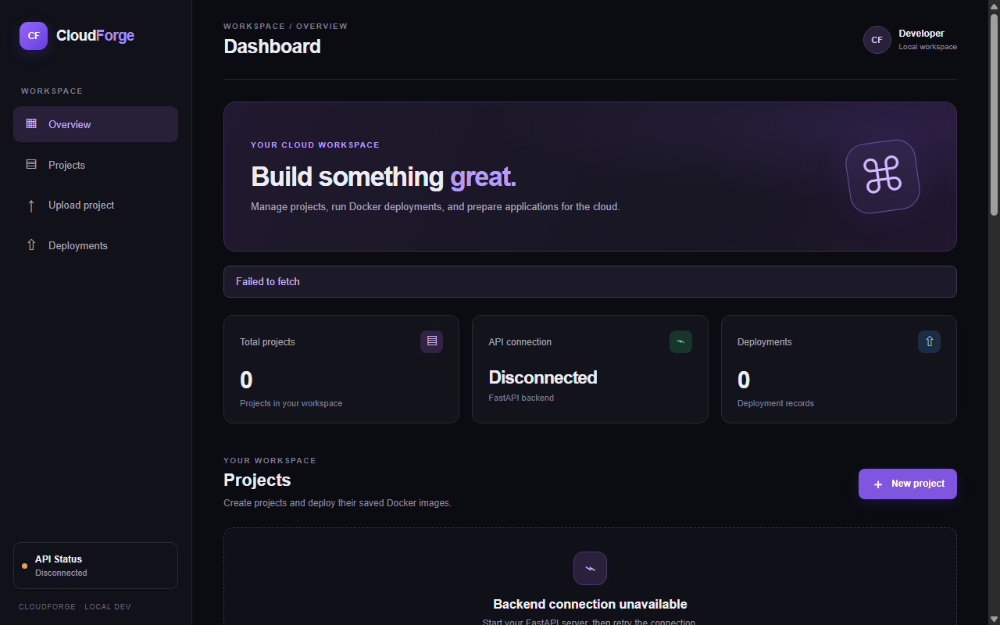
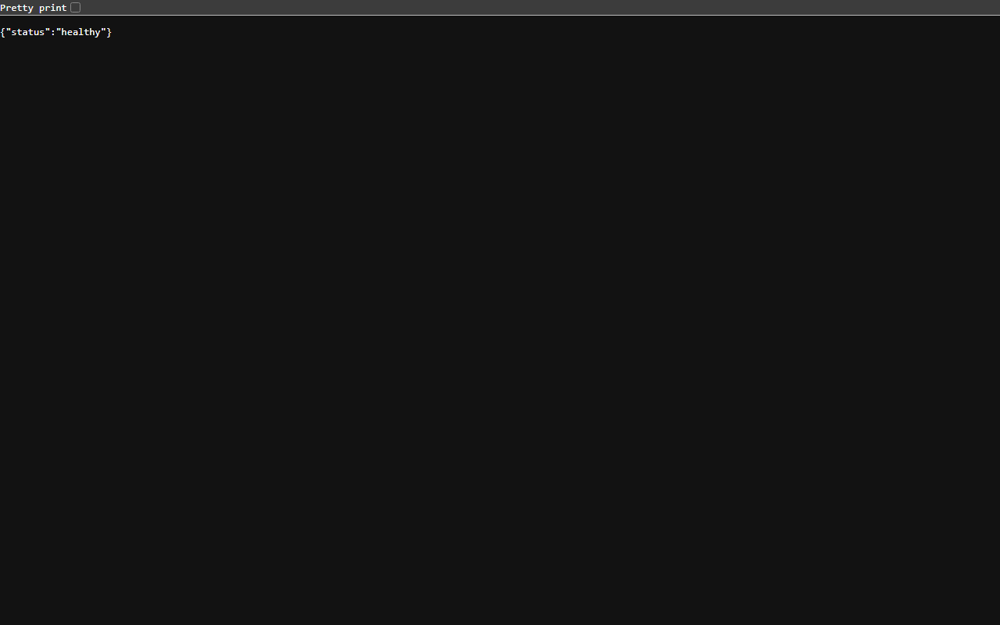
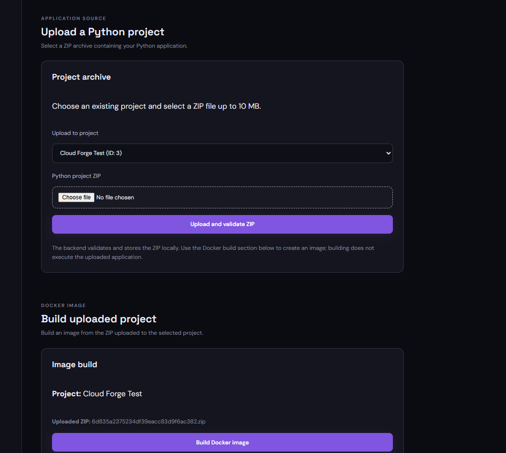
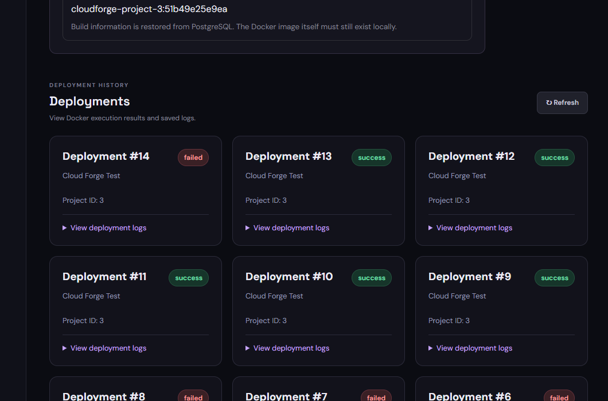

# Cloud Forge: A Cloud-Native Containerized Application Build and Deployment Platform Deployed on AWS

**Academic Case Study — Submission Date: October 2026**  
**Student:** Eben John Jose · **Reg. No.:** 24BCE2459  
**Programme / Branch:** [e.g., B.Tech in Computer Science and Engineering]  
**Institution:** [e.g., School of Computer Science and Engineering, Vellore Institute of Technology (VIT)]  
**Course / Module:** [e.g., Capstone Project / Cloud Computing & DevOps Lab]  
**Live Public Deployment:** http://54.252.152.116/  
**Repository:** https://github.com/Eben923/cloud-forge (Private · Commit `f484692`)

---

> **Live AWS Production Deployment:** Cloud Forge is provisioned and deployed to Amazon Web Services (AWS) in region `ap-southeast-2` (Sydney). The system operates on an isolated Amazon EC2 Nitro instance with reverse-proxy traffic control via Nginx, persistent containerized PostgreSQL data storage, and local container execution sandbox boundaries.

---

## 1. Title

**Cloud Forge: A Cloud-Native Containerized Application Build and Deployment Platform Deployed on AWS**

---

## 2. Project Overview

### Problem Statement
Deploying small web applications, microservices, and scripts typically demands manual server setup, complicated container networking, or expensive cloud PaaS layers. Developers require a secure, lightweight, and cost-controlled platform capable of ingesting source archives, compiling Docker containers safely, executing code within kernel-level resource ceilings, and logging runtime audits persistently.

### Cloud Forge on AWS Architecture
Cloud Forge has been fully deployed on AWS in region **ap-southeast-2 (Sydney)** utilizing an optimized multi-tier architecture:
- **Cloud Compute:** Amazon EC2 `t3.micro` (2 vCPUs, 1 GiB RAM, Nitro architecture) running Amazon Linux 2023.
- **Networking & Ingress Defense:** Amazon VPC (`vpc-0386d45395fe28fab`) with an Internet Gateway, public routing, and dedicated Security Group (`sg-0e80b98f2baa7f9f4`). SSH (Port 22) is locked exclusively to the administrator IP (`182.156.30.24/32`), while Port 8000 is blocked from external access.
- **Reverse Proxy & Web Tier:** Production Nginx 1.30 server exposing Port 80, delivering the compiled React 19 SPA, and securely routing internal API endpoints to FastAPI at `127.0.0.1:8000`.
- **Application Backend:** FastAPI (Uvicorn ASGI) running as a persistent `systemd` daemon with auto-recovery and strictly isolated environment configuration.
- **Persistent Data Tier:** PostgreSQL 15 running in a persistent container with volume mounts mapping to `/var/lib/cloudforge/pgdata` on the EC2 host.
- **Sandbox Runtime:** Docker 25.0 Engine orchestrating non-root image builds and ephemeral container executions governed by cgroup quotas.

### Verified Technology Stack

| Layer | Technology | AWS Cloud Configuration |
| :--- | :--- | :--- |
| **Cloud Infrastructure** | AWS EC2 (Nitro) | `t3.micro`, Amazon Linux 2023, AMI `ami-0ddbd63d0e3325a92` |
| **Cloud Security & Network** | AWS VPC & Security Groups | VPC `vpc-0386d45395fe28fab`, SG `sg-0e80b98f2baa7f9f4` (SSH locked to /32) |
| **Web & Reverse Proxy** | Nginx 1.30.5 | Port 80 Ingress, Static Asset Hosting, Internal Proxy to 127.0.0.1:8000 |
| **Frontend Client** | React 19, Vite | Compiled SPA served via Nginx root `/var/www/cloudforge` |
| **Backend REST API** | FastAPI 0.162, Uvicorn | Systemd Service `cloudforge.service` (Port 8000 Localhost only) |
| **Persistent Database** | PostgreSQL 15 (Alpine) | Host Volume Mount `/var/lib/cloudforge/pgdata`, 127.0.0.1:5432 |
| **Isolation Engine** | Docker 25.0 Engine | Linux cgroups, non-root user, dropped capabilities, no network mode |

---

## 3. Methodology / Working Model

1. **Secure Ingress & Routing:** Client web traffic arrives at public IP `54.252.152.116:80`. Nginx handles static file delivery directly for the React dashboard. When an API call is made (e.g., `/projects`, `/health`), Nginx securely forwards the request to `127.0.0.1:8000`. Port 8000 is inaccessible to the public internet, preventing bypass of the proxy layer.
2. **Project & Archive Management:** Projects are registered via REST calls. The backend creates unique workspaces under `/home/ec2-user/app/build_projects/`. Uploaded ZIP files are checked against path traversal (Zip Slip protection).
3. **Container Image Compilation:** Cloud Forge inspects the application entry point and generates a sanitized `python:3.13-slim` Dockerfile. The image is built using `network_mode="none"` to prevent unauthorized outbound connections during compilation.
4. **Sandboxed Execution:** Containers are spun up with strict resource quotas:
   - Memory ceiling: 128 MiB
   - CPU quota: 0.5 vCPU (500,000,000 nano-CPUs)
   - Linux capabilities: Dropped (`cap_drop=["ALL"]`)
   - Filesystem: Read-only root (`read_only=True`)
   - Network: Completely disabled (`network_disabled=True`)
   - User: Unprivileged (`user="nobody"`)
   - Watchdog: 30-second execution cutoff timeout
5. **Relational Persistence:** Projects, deployment runs, exit codes, and stdout/stderr logs are saved into PostgreSQL. Because data is volume-mapped to `/var/lib/cloudforge/pgdata`, records persist indefinitely across container and service restarts.

---

## 4. Genuine Application Screenshots & Verification Evidence

All screenshots demonstrate the live deployment running on Amazon Web Services in Sydney.

### Figure 1: Cloud Forge Dashboard Live on AWS EC2
*Live Cloud Forge dashboard hosted on AWS EC2 (http://54.252.152.116/), showing API Connected and project workspace.*


---

### Figure 2: AWS Health Endpoint
*Verified live AWS health endpoint response at http://54.252.152.116/health returning `{"status":"healthy"}` through Nginx reverse proxy.*


---

### Figure 3: Application Archive Upload & Docker Build
*Archive validation and compiled Docker image synthesis.*


---

### Figure 4: Sandboxed Container Execution
*Execution audit trail capturing container run limits, exit code 0, and output logs.*


---

### AWS Infrastructure Verification Records
```text
================================================================================
AWS Cloud Verification Summary (ap-southeast-2)
================================================================================
Instance ID:        i-0a2230a900eee725f (cloud-forge-server)
Instance Type:      t3.micro (AWS Free Tier Eligible)
Public IPv4:        54.252.152.116
Public DNS:         ec2-54-252-152-116.ap-southeast-2.compute.amazonaws.com
VPC ID:             vpc-0386d45395fe28fab
Security Group:     sg-0e80b98f2baa7f9f4 (SSH restricted to 182.156.30.24/32)
Web Ingress:        Port 80 (Nginx Reverse Proxy)
Backend Binding:    127.0.0.1:8000 (Internal Only)
Database:           PostgreSQL 15 (Docker, Persistent Mount /var/lib/cloudforge/pgdata)
Health Endpoint:    http://54.252.152.116/health -> {"status":"healthy"}
Projects Endpoint:  http://54.252.152.116/projects -> HTTP 200 OK
================================================================================
```

---

## 5. Project Link on GitHub and Academic Details

**GitHub Repository:** https://github.com/Eben923/cloud-forge
- **Visibility:** Private
- **Live Public Cloud Deployment:** http://54.252.152.116/
- **Tracked Branch:** `main`
- **Latest Commit SHA:** `f484692`

---

**Author:** Eben John Jose  
**Registration Number:** 24BCE2459  
**Programme / Branch:** [e.g., B.Tech in Computer Science and Engineering]  
**Department / School:** [e.g., School of Computer Science and Engineering (SCOPE)]  
**Institution:** [e.g., Vellore Institute of Technology (VIT), Vellore]  
**Submission Date:** October 2026
